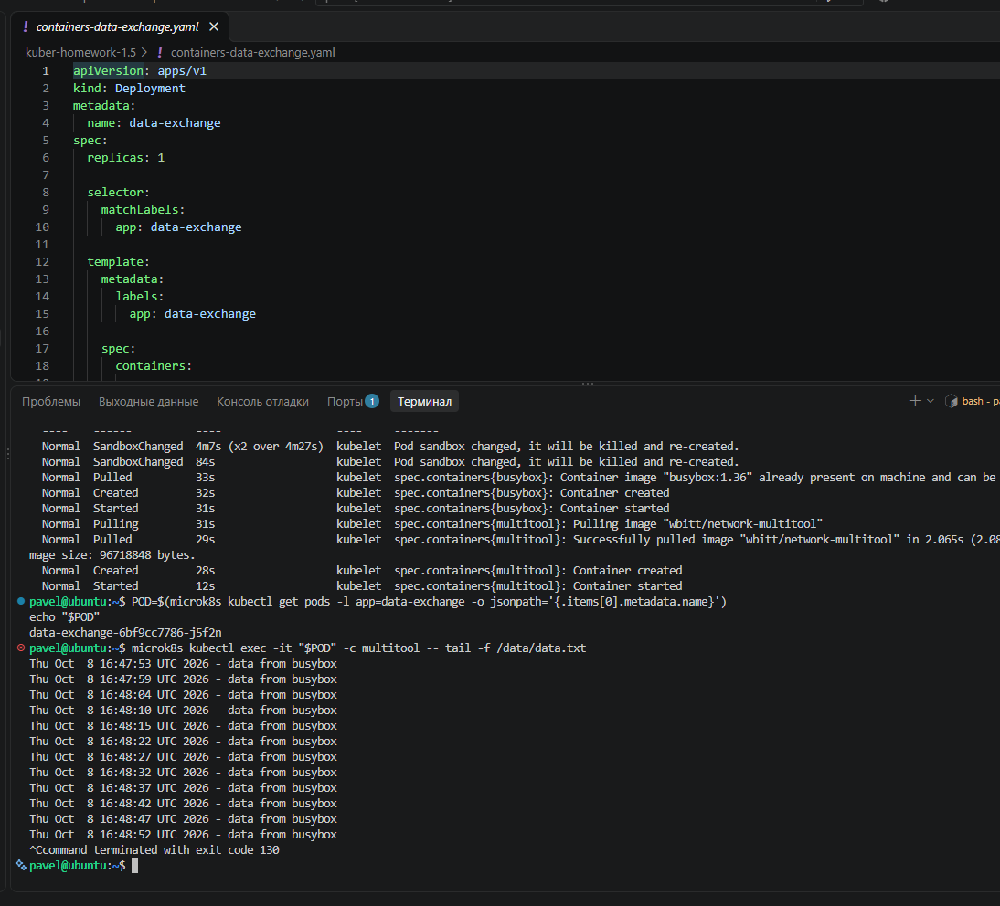
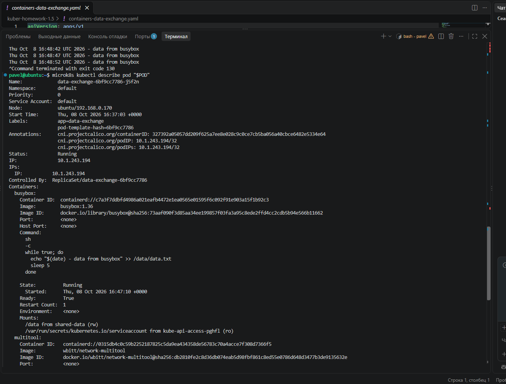
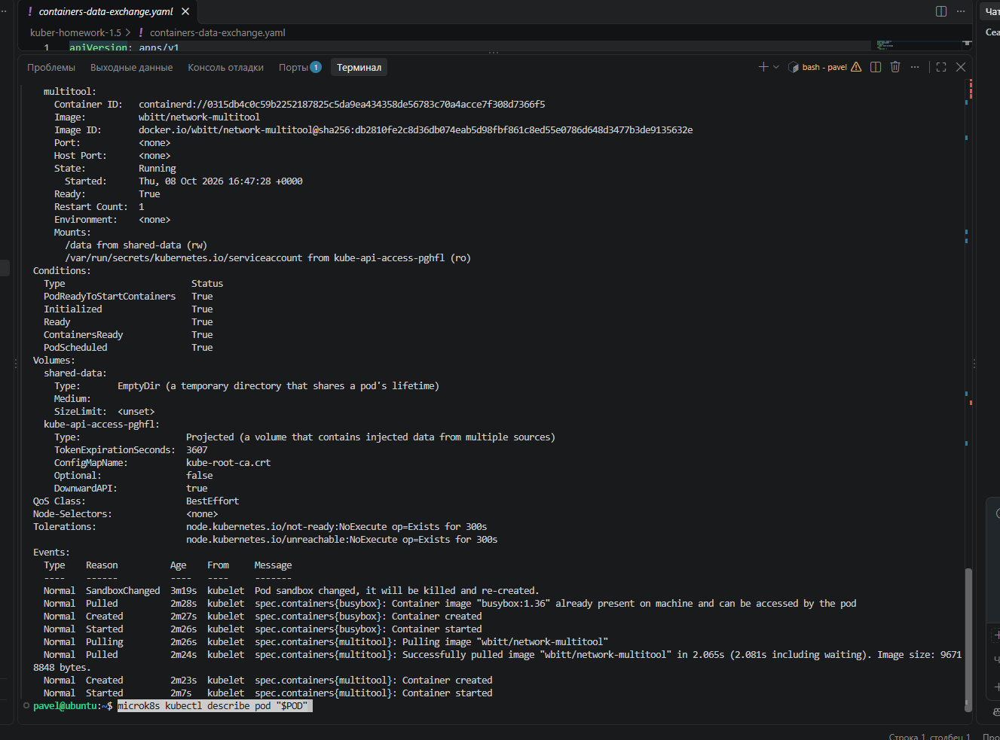
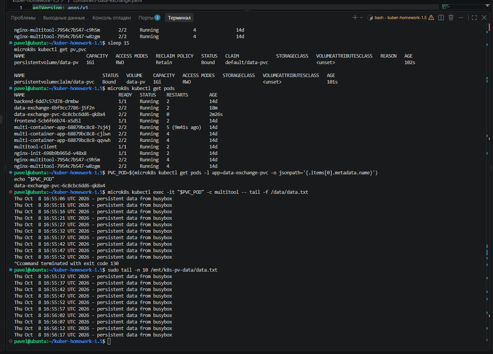
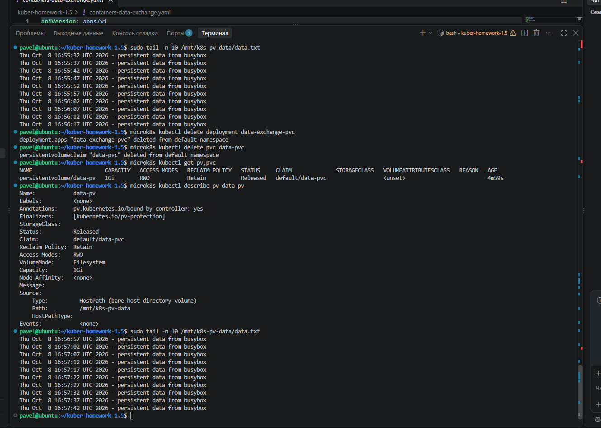
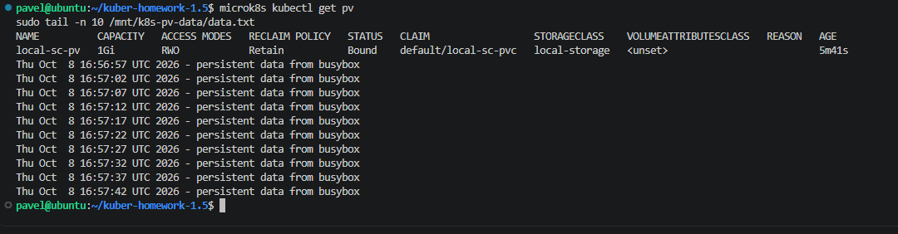
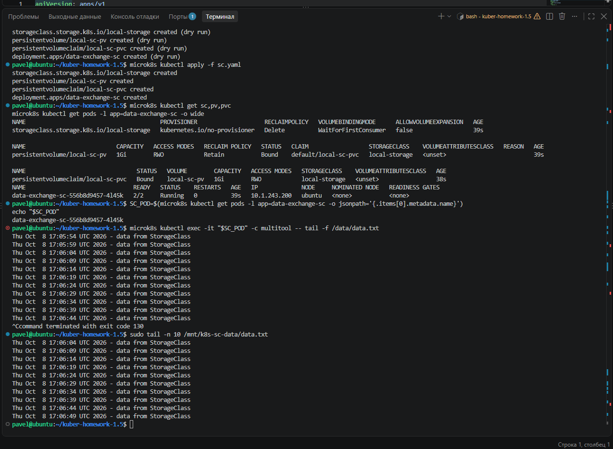

# Домашнее задание к занятию «Хранение в K8s»

В работе использован одновузловой кластер MicroK8s. Выполнены три задания: обмен данными между контейнерами через `emptyDir`, работа с вручную созданными `PV/PVC` и подключение локального хранилища через собственный `StorageClass`.

## Задание 1. Volume: обмен данными между контейнерами в Pod

Манифест: [containers-data-exchange.yaml](./containers-data-exchange.yaml)

Создан Deployment `data-exchange` с двумя контейнерами:

- `busybox` записывает строку с текущей датой в `/data/data.txt` каждые 5 секунд;
- `multitool` читает этот же файл;
- для обмена данными используется общий том `emptyDir`, смонтированный в `/data` в обоих контейнерах.

Схема:

```text
Pod data-exchange
├── busybox   -> /data/data.txt
├── multitool <- /data/data.txt
└── emptyDir: shared-data
```

Проверка чтения файла из контейнера `multitool`:

```bash
POD=$(microk8s kubectl get pods -l app=data-exchange -o jsonpath='{.items[0].metadata.name}')
microk8s kubectl exec -it "$POD" -c multitool -- tail -f /data/data.txt
```



Описание Pod подтверждает наличие двух контейнеров и общего тома `shared-data` типа `EmptyDir`.





`emptyDir` существует в течение жизненного цикла Pod. Контейнеры одного Pod могут использовать его совместно, но после удаления самого Pod данные этого тома не сохраняются.

---

## Задание 2. PersistentVolume и PersistentVolumeClaim

Манифест: [pv-pvc.yaml](./pv-pvc.yaml)

На ноде создан каталог:

```bash
sudo mkdir -p /mnt/k8s-pv-data
```

Для него вручную созданы:

- `PersistentVolume` `data-pv` размером `1Gi`;
- `PersistentVolumeClaim` `data-pvc` с запросом `500Mi`;
- Deployment `data-exchange-pvc` с контейнерами `busybox` и `multitool`.

PV использует локальный каталог ноды:

```yaml
hostPath:
  path: /mnt/k8s-pv-data
```

После создания ресурсов PV и PVC перешли в состояние `Bound`, Pod запустился в состоянии `2/2 Running`. Контейнер `multitool` успешно читает данные, которые `busybox` записывает в общий файл. Те же данные доступны непосредственно на ноде в `/mnt/k8s-pv-data/data.txt`.



### Что произошло после удаления Deployment и PVC

Выполнено:

```bash
microk8s kubectl delete deployment data-exchange-pvc
microk8s kubectl delete pvc data-pvc
microk8s kubectl get pv,pvc
microk8s kubectl describe pv data-pv
```

После удаления PVC том `data-pv` перешёл из состояния `Bound` в `Released`.

Причина — у PV указана политика:

```yaml
persistentVolumeReclaimPolicy: Retain
```

Политика `Retain` означает, что после удаления PVC Kubernetes не удаляет сохранённые данные автоматически. Сам PV уже освобождён от существующего claim, но данные остаются на локальном диске и требуют ручного управления.



Файл при этом сохранился в каталоге ноды:

```text
/mnt/k8s-pv-data/data.txt
```

### Что произошло после удаления PV

После проверки был удалён объект PV:

```bash
microk8s kubectl delete pv data-pv
```

Объект `data-pv` исчез из Kubernetes, однако физический файл в `/mnt/k8s-pv-data/data.txt` сохранился.



Это происходит потому, что `PersistentVolume` в данном случае является объектом Kubernetes, описывающим локальное хранилище. Удаление объекта PV не является удалением каталога `hostPath` на файловой системе ноды. Дополнительно использовалась политика `Retain`, поэтому данные должны сохраняться для ручного управления администратором.

---

## Задание 3. StorageClass

Манифест: [sc.yaml](./sc.yaml)

Создан собственный StorageClass:

```yaml
provisioner: kubernetes.io/no-provisioner
volumeBindingMode: WaitForFirstConsumer
```

Также создан локальный PV `local-sc-pv`, PVC `local-sc-pvc` и Deployment `data-exchange-sc`.

Поскольку используется `kubernetes.io/no-provisioner`, StorageClass не создаёт PersistentVolume автоматически. Поэтому подходящий локальный PV объявлен вручную. Для локального тома задана привязка к ноде `ubuntu` через `nodeAffinity`.

Каталог на ноде:

```text
/mnt/k8s-sc-data
```

После запуска:

- StorageClass `local-storage` создан;
- PV `local-sc-pv` находится в состоянии `Bound`;
- PVC `local-sc-pvc` находится в состоянии `Bound`;
- Pod `data-exchange-sc` запущен `2/2 Running`;
- `multitool` читает строки, записываемые `busybox` каждые 5 секунд;
- те же данные присутствуют в `/mnt/k8s-sc-data/data.txt` на ноде.



---

## Итог

В ходе работы проверены три способа подключения хранилищ:

| Механизм | Назначение | Что происходит с данными |
|---|---|---|
| `emptyDir` | Обмен файлами между контейнерами одного Pod | Удаляются вместе с Pod |
| `PV/PVC` + `hostPath` | Постоянное локальное хранилище | Сохраняются на диске ноды |
| `StorageClass` + `PVC` + local PV | Выбор хранилища через StorageClass | Данные сохраняются в локальном PV |

Главное отличие постоянных томов от `emptyDir`: жизненный цикл данных можно отделить от жизненного цикла Pod. В заданиях 2 и 3 данные физически хранятся на ноде и доступны независимо от пересоздания контейнеров.
